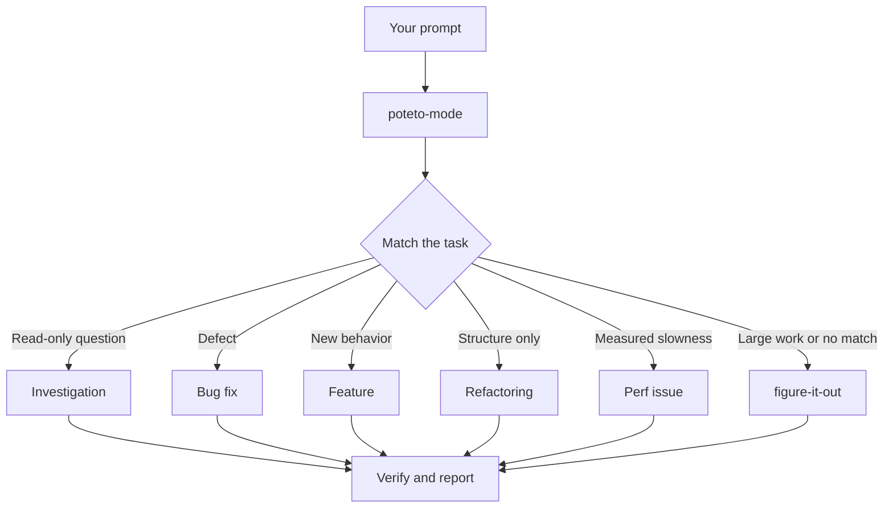
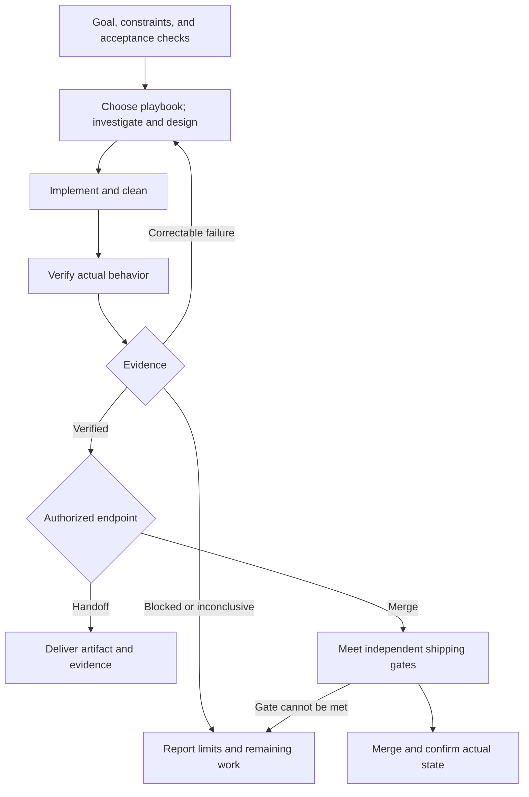

# Route work through `/skill:poteto-mode`

`/skill:poteto-mode` takes a goal and matches it to one of 22 playbooks. It copies that playbook's steps into `TODO.md` and calls the other skills as the steps need them. This page shows what a prompt needs and how a short one routes.


## How a prompt routes



The diagram shows the common routes. Other playbooks cover these tasks:

- hillclimbing a metric
- diagnosing runtime symptoms and captured traces
- prototypes and visual parity
- authoring and evaluating skills
- autonomous runs
- opening a pull request, babysitting one to merge-ready, and shipping a verified stack
- running a pull request queue or a stack on autopilot
- session pickup and pausing safely
- multi-phase plans and worktree cleanup

The [playbook directory](../../skills/poteto-mode/playbooks/) has the full set.

## How code work is accepted

Code-producing work ends on evidence:



The diagram shows acceptance and handoff, not the timing of every step. Autopilot-full opens its pull request while implementation and verification still run. Investigation and multi-phase plans stop at their findings or plan. `/skill:reflect` and `/skill:correct` run only when you ask.

Opening a pull request does not grant a merge. Without a merge grant, you get the pull request and its evidence. With one, the Shipping playbook lands it behind an independent verifier and reads the merge state back.

## State the goal

Say what is wrong or what you want, plus anything you already know:

```text
/skill:poteto-mode users get two notifications after a retry. repro first, then fix and verify.
```

That is a Bug fix prompt. The playbook honors "repro first" as a constraint, and `TODO.md` fills with the Bug fix steps.

## What goes in a prompt

A prompt carries up to five things, each in one sentence:

- **The goal.** Say what is wrong or what you want.
- **The done check.** It must be able to pass or fail. "Make it better" and "work on it for an hour" are not checks.
- **The proof you want.** Ask for real command output, a video of the flow, the stored value, or a before-and-after number.
- **What you already know.** A symptom, a repro step, a log line, or a link saves the agent a search.
- **The constraints.** "repro first", "don't change any code yet", "zero behavior change", and "let me review before proceeding" each change what the agent does.

This prompt has all five:

```text
/skill:poteto-mode the csv export drops its last row since yesterday's deploy. failing job id is 4812. repro first, then fix. done means the 60k-row fixture exports every row. show me the row counts before and after.
```

Leave two things out:

- **The method.** Say what to achieve, and let the agent find a better path than the one you would pick. The same goes for a list of skills.
- **Your theory of the cause, at first.** A stated guess narrows the search to where you pointed. Let the agent restate the problem before you share your guess.

For a noisy report, such as a long thread or a vague bug, make the restatement the first step:

```text
/skill:poteto-mode read this thread. restate the underlying issue in your own words, in plain english. don't change any code yet.
```

A misreading shows up in the restatement, before any code exists. Correcting it costs one message. For the restatement alone, run [`/skill:in-your-own-words`](../../skills/in-your-own-words/SKILL.md). It restates the goals and the problem the agent thinks you have.

To check a prompt before you send it, run [`/skill:sharpen`](../../skills/sharpen/SKILL.md) on it:

```text
/skill:sharpen write a migration guide for the v2 config format.
```

The agent names what a top professional would do that you did not ask for. It lists the raw material they would start from, the methods and tools they would use, and what other than you or the agent would show the result is right. Then it rewrites your prompt to ask for exactly that, deeper but not bigger. The rewrite asks the agent to prototype any choice an experiment can settle and to recommend an option from what it observed. Product and preference choices stay with you. `/skill:sharpen` does not do the task. Read the rewrite, then send it, for example with `/skill:poteto-mode`.

## Follow up short

When the conversation already carries the context, a short prompt is enough:

```text
/skill:poteto-mode do it
```

```text
continue
```

```text
keep going until done
```

The playbook holds the structure, so your words only need to carry the intent. `/skill:poteto-mode` attaches the skill to the one message it is typed in, and its influence fades as the session moves on. Send `/skill:poteto-mode` again with each new task, or type `/pstack-mode poteto-mode` to keep the skill in the system prompt on every turn. [Set up pstack](./01-setup.md#run-your-first-task) covers both.

## Switch tasks with "new task"

A long chat accumulates context from the last task. When you change subjects, say so:

```text
/skill:poteto-mode new task. figure out why the cache entry survives logout. don't change any code yet.
```

"new task" tells `/skill:poteto-mode` to match a fresh playbook instead of continuing the prior one. "don't change any code yet" pins this one to Investigation. Without those phrases, a session in the middle of a Feature may treat your question as the next feature step.

## Give parallel work its own worktree

Several agents in one working tree overwrite each other's files and share ports and build output. A git worktree for each worker prevents the file collisions. A worktree does not isolate ports, so give each worker's dev server its own port.

`subagent` has no `worktree` parameter. Use one of these:

- Set `isolation: "worktree"` on the `subagent` call or on a task. The call creates a git worktree for that worker. It keeps the worktree, and reports it, only if the worker leaves changes or commits.
- Create the worktree yourself on the host with `tmux_run` running `git worktree add -b <branch> .pi/worktrees/<slug> <ref>`, and pass its path as `cwd`. The path is inside the working directory, so the worker's VM can edit it.

The worker's VM mounts only its own checkout, so it can install dependencies, run your app, and record video without touching your working tree.

You can ask for a worktree in the prompt:

```text
/skill:poteto-mode new task. branch off <base> in a fresh worktree, then port the parser change there.
```

The [Opening a PR playbook](../../skills/poteto-mode/playbooks/opening-a-pr.md) already works from a worktree for code changes. Name a base or a location only when it matters. Worktrees cost disk space, so a laptop holds only a handful at once.

When disk space runs low, ask:

```text
/skill:poteto-mode what's eating my disk? prune the worktrees that are safe to prune.
```

The [Worktree cleanup playbook](../../skills/poteto-mode/playbooks/worktree-cleanup.md) classifies each worktree by merge state, uncommitted work, and which chats still touch it. It deletes only what that evidence clears. It stops for your decision on anything with uncommitted work.

## Leave it running

When you step away, state what done means:

```text
/skill:poteto-mode im stepping away. keep going until the migration check reports zero old callers. log your decisions.
```

Work you will review later routes through [`/skill:figure-it-out`](../../skills/figure-it-out/SKILL.md). It designs the run's phases and keeps a [`/skill:show-me-your-work`](../../skills/show-me-your-work/SKILL.md) decision log. [Run work overnight](./07-overnight.md) covers the full contract.

**Pitfall.** Do not list skills in your prompt, as in "use /skill:architect, then /skill:arena, then /skill:interrogate". The playbook already sequences them. A hand-written sequence can reorder or drop steps the playbook would keep. Name a skill only to override a specific choice.

[`poteto-mode`](../../skills/poteto-mode/SKILL.md) has the full routing rules.

Next: [Understand the code](./03-understand.md).
