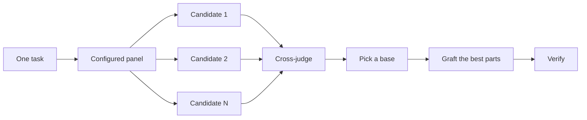

# Design before you write code

A single attempt at a hard design keeps the first shape the model thought of. Each skill on this page counters that:

- `/skill:architect` settles types and boundaries before implementation.
- `/skill:arena` runs several attempts at the same brief and merges the best parts.
- `/skill:interrogate` has adversaries on other models try to break a change, a design, or a plan.
- `/skill:swarm` fans out slices or races for coverage and aggregates the results.

Two design mistakes are common. One is accepting the agent's first design. The other is polishing a plan that no code has tested. Prototypes answer the open questions, a README or tutorial sets the target, and the written plan comes last.


## Settle the shape with `/skill:architect`

```text
/skill:architect design the import pipeline before writing any code. i care most about how callers use it.
```

[`/skill:architect`](../../skills/architect/SKILL.md) first traces every system the change touches. It then sketches two different shapes, each with types, signatures, and module boundaries. It picks the shape where each piece of state has one owner, each task has one way to do it, and callers need to know the least. For a large or contested design, it runs `/skill:arena` instead of sketching alone. To see the design before any code, say so in the prompt.

The design can change once code starts. When the same workaround keeps coming back, `/skill:architect` redesigns instead of patching around it.

## Fan out attempts with `/skill:arena`

```text
/skill:arena take my prompt to the arena verbatim. i want to compare their proposals with yours.
```

[`/skill:arena`](../../skills/arena/SKILL.md) is the general tool under `/skill:architect`. N subagent workers attempt the same design or code brief in parallel, each writing to its own worktree or directory. A read-only judge from a different model vendor scores every candidate against a rubric. When no model from another vendor can run, the coordinator skips the judge and picks the base alone. The coordinator reads each candidate end to end, picks a base, grafts in the best ideas from the losers, and verifies the result.



The panel comes from your [`/skill:setup-pstack`](../../skills/setup-pstack/SKILL.md) configuration, and you can change it per task. Ask for more candidates when the decision is costly to reverse and fewer when it is not:

```text
/skill:arena this, 5 candidates. the cache key format is expensive to change later.
```

## Cover slices and races with `/skill:swarm`

```text
/skill:swarm check every package under packages/ against its check.sh. one worker per package. one report.
```

[`/skill:swarm`](../../skills/swarm/SKILL.md) fans N workers across independent slices, coverage matrices, gauntlet lanes, exploration partitions, or declared race arms. Each worker is a subagent worker with its own scope and check. It reports `PASS`, `ISSUES`, or `BLOCKED`. The `subagent` call blocks until every worker finishes and returns all reports together. The parent then returns one consolidated report that lists any gaps or dropouts.

Use `/skill:swarm` when parallelism buys coverage or lets independent checks race. `/skill:arena` gives every worker the same design or code brief, then picks a base and grafts the best parts. `/skill:swarm` covers slices, or runs a race whose selection rule you declare up front. It does not pick a base or graft.

## Break it with `/skill:interrogate`

```text
/skill:interrogate the whole branch, but skeptically. no nitpicks unless it's an actual bug or regression.
```

[`/skill:interrogate`](../../skills/interrogate/SKILL.md) covers code changes, designs, and plans. It gives the change and its intent to adversaries on the configured models. Each adversary tries to break it with a run. For a design or plan, an adversary runs a prototype or probes the current tree. A finding survives only when rerunning its command shows a failure that breaks the intent. The report lists every verified finding with the adversaries that found it. It then lists what each adversary dropped and why. It applies no fixes.

Read the Dropped list as well. You can override the verdict.

## Prototype instead of debating

Ask for several options and pick from evidence you can see:

```text
/skill:poteto-mode prototype a few options for the new dropdown menu. take screenshots or videos for me to compare.
```

The [Prototype playbook](../../skills/poteto-mode/playbooks/prototype.md) builds throwaway sketches in a scratch directory and puts the variants behind one switcher. It drives each variant and captures screenshots or timings. It also works for behavior and algorithms, not only UI. Prototypes let the agent answer its own open questions by running something instead of asking you. They also leave room for an option you would not have thought of.

For a real design, pair `/skill:architect` with prototypes and keep a review gate:

```text
/skill:poteto-mode we need rate limiting for external webhooks. /skill:architect it first, and answer open questions with prototypes. let me review before proceeding.
```

`/skill:interrogate` also fits a written design or plan before any code exists. Its adversaries run prototypes or probe the tree, and it drops every finding a run does not prove. Prototype the open questions first, so the adversaries have evidence to test.

## Write the README first for shared code

For a package or API that other code will use, start with the document a user would read:

```text
/skill:poteto-mode write a tutorial for how i would use the new config package first. then /skill:teach me why it beats the current one.
```

Writing the tutorial first forces the caller's view. You describe the API to a hypothetical user and work back to the implementation. The document also becomes a concrete target for the agent's own checks. Name [`/skill:technical-writing`](../../skills/technical-writing/SKILL.md) when the document itself matters. It keeps a tutorial a tutorial and stops it from mixing in reference and explanation.

## Plan after the design settles

pstack has no planning skill. When you want a written plan, ask for it once the design is settled:

```text
/skill:poteto-mode turn this design into a plan. small verifiable PRs, each with its own verification steps.
```

The [Multi-phase plan playbook](../../skills/poteto-mode/playbooks/multi-phase-plan.md) settles open questions by prototype. It then writes a plan file with one section per pull request. Each section has unit, live, and perf checkboxes, and a pull request counts as verified only when all three are checked. A passing test suite alone does not verify a pull request. The playbook specifies no fixed path for the plan file, so say where you want it. You review the file. The plan is the deliverable, and the playbook does not implement it. Execution starts when you say go.

For a migration, state the bar in the prompt:

```text
/skill:poteto-mode plan the migration of our ui library to the new styling system. small verifiable PRs, each with visual regression checks. the result must match the original exactly, bugs included.
```

"bugs included" stops the migration from fixing bugs along the way, which would make the old and new output impossible to compare. For a project that spans many days, you can commit the plan file so other agents see the work in progress. Delete it when the work lands.

## Choose how much design work a task needs

Most changes need none of this. Use this ladder:

- A small, finished change you doubt needs `/skill:interrogate` alone.
- A change that crosses function boundaries or moves ownership needs `/skill:architect`. It brings `/skill:arena` when the design is large or contested.
- A standalone decision where independent attempts help, such as naming, formats, or an algorithm, goes to `/skill:arena` directly.
- A coverage matrix, a set of parallel checks, or a race with declared arms goes to `/skill:swarm`.
- An open question that running something can answer, such as a layout, a timing, or an approach, gets a prototype.
- A contested design that is costly to reverse gets `/skill:architect`, then `/skill:interrogate` before shipping.
- Work that spans several pull requests gets a plan, written after the design settles.

`/skill:poteto-mode` already applies this ladder, and boundary-crossing work triggers `/skill:architect` without a request. Call these skills directly when you want more or less scrutiny than the default.

Next: [Build and clean the change](./05-build-and-clean.md).
