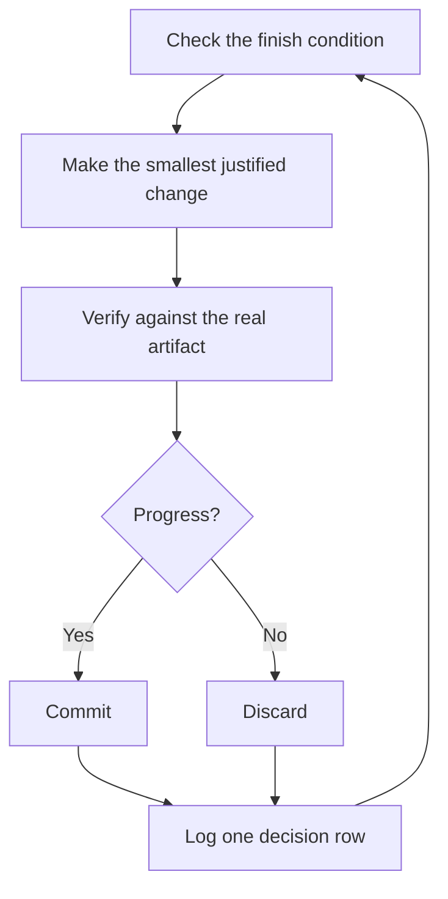

# Run work overnight

An agent that verifies its own work can run a hard task unattended. Three things make that safe: a finish condition the agent can check, an isolated worktree, and a decision log that you audit in the morning.


## Check that the loop has earned your trust

A loop you do not trust produces unchecked work faster, and each iteration adds more of it. Before you leave a loop running, confirm these four points:

- You have done the task once by hand, or watched an agent do it, so you know what good looks like.
- The agent has the tools and signals you would use: the verification skill, the profiler, and the logs.
- Every stage proves its work and can stop the line when the work misses the bar.
- You have read a few transcripts and turned the repeated failures into tools, skills, or checks.

Until all four hold, run the loop while you watch.

## Write the overnight contract

A handoff states the goal, the finish condition, the permissions, and an escape hatch. It can be short:

```text
/skill:poteto-mode im going to bed. migrate every caller to the new parser in a fresh worktree off <base>.
done means zero old callers, all parser fixtures pass, old api deleted.
keep a decision log. don't ask me before committing.
keep a heartbeat running until done. if you're truly stuck after a few hours, stop and write up why.
```

Each line does a specific job:

- "im going to bed" is a session override. The agent stops asking and keeps going.
- "done means..." turns the goal into checks that every iteration can run.
- "fresh worktree off `<base>`" keeps the run from colliding with anything else you have open.
- "don't ask me before committing" answers in advance the permission question that would otherwise block the agent.
- The heartbeat is a `tmux_run` job, not a skill. A watcher job runs with a `wake` message and wakes your session when it exits. A timer job runs `sleep <seconds>` with `repeat: true`, and each tick wakes the session with the tick prompt. The [Autonomous run playbook](../../skills/poteto-mode/playbooks/autonomous-run.md) uses both to re-check the finish condition on events or on a timer. Stop a heartbeat with `tmux_jobs` and `action: "stop"`.
- The escape hatch lets the agent stop at a real dead end and write up why. That beats eight hours of reinterpreting the goal.

Pi has no permission popups. The Gondolin VM limits Pi's built-in tools instead:

- Guest tools can reach `/workspace`, which is the directory Pi started in. Writes to `.git/hooks` and `.git/config` there are denied.
- The package root, out-of-workspace skill directories, and `<agentDir>/pstack-v2/subagents` (where wake-job `.output` files live) are mounted read-only.
- A subagent's memory directory is mounted writable when `PI_SUBAGENT_MEMORY_DIR` names an existing directory outside `/workspace`.
- `/cache` is mounted writable when the shared build cache is enabled.

`tmux_run` jobs and the `pi` processes that `subagent` starts run on your machine, outside the VM. [Set up pstack](./01-setup.md#check-the-requirements) describes the boundary.

Because you will review this work after stepping away, `/skill:poteto-mode` routes it through [`/skill:figure-it-out`](../../skills/figure-it-out/SKILL.md). That skill designs the run's phases before any code and sets up the decision log.

To stop a run on purpose, tell the agent to pause, or say that you are about to go offline or restart Pi. The [Pause safely playbook](../../skills/poteto-mode/playbooks/pause-safely.md) finishes or backs out of the current step, commits a work-in-progress checkpoint, and writes a resume note. A fresh session reconstructs the state from the session transcript, the job directory, the branch, and `TODO.md` through the Session pickup playbook; the resume note records where the pause left off. "keep going" never triggers a pause.

## What the loop does



Each iteration makes one change, runs one check, and writes one log row. The loop discards changes that did not help. A plateau means the loop changes approach. The loop does not relax the finish condition to declare success.

## Audit the log in the morning

[`/skill:show-me-your-work`](../../skills/show-me-your-work/SKILL.md) keeps the run reviewable. Each row records the time, phase, decision, reason, an evidence pointer, and the result. The log is a tab-separated file at `decisions.tsv`, or `.audit/<task-slug>.tsv` when several runs share a directory. It stays out of git by default. Commit it when a reviewer needs the trail to trust the result.

When you return, ask for the run in review form:

```text
/skill:show-me-your-work catch me up on what you did last night
```

Before the skill hands back its summary, it starts a reviewer on a model from a different vendor when one is available, otherwise on the session model, and says which. The reviewer reads the trail and the transcript. The reply ends with an Attention section that lists what deserves your scrutiny. Read that section first, then the log rows it points at. You audit decisions and do not need to re-read the whole night.

For a quick status instead of an audit, run [`/skill:ketchup`](../../skills/ketchup/SKILL.md) in the session that ran the work. It only reads. It reports in plain words what changed since your last message, with the screenshots and small diagrams the work produced. It then lists each call waiting on you, such as a merge, an approval, or a choice between options. Each entry has the skill's pick, the evidence, and the risk, so you can decide from the reply alone.

## Run a queue instead of a task

The contract above drives one task to one finish condition. A queue of independent changes, or a whole program, needs two playbooks and one skill.

[Autopilot-full](../../skills/poteto-mode/playbooks/autopilot-full.md) runs a queue of independent pull requests to merged. Each pull request has one owner agent that carries it from build through merge, and no owner merges on its own verdict. A swarm of fresh verifiers checks the owner's code-ready head. A later rebase or minor fix gets one fresh verifier. New behavior, a large new diff, or a redesign calls the full swarm again; a wording-only change gets no verifier. Only a clean verdict on the patch that merges authorizes the merge:

```text
/skill:poteto-mode full autopilot on this queue. each item is independent. i want them merged by morning.
```

[Autopilot-stack](../../skills/poteto-mode/playbooks/autopilot-stack.md) is Autopilot-full without the merge. You wake up to verified pull requests, each with its verdict, and you review and land them yourself. A pull request stacks only on a pull request it builds on. Choose it over Autopilot-full when you want to review the work before anything merges:

```text
/skill:poteto-mode autopilot these five changes, but don't merge. i'll land them in the morning.
```

A whole program, such as a migration across many packages, has no playbook of its own. `/skill:poteto-mode` routes large or cross-cutting work to [`/skill:figure-it-out`](../../skills/figure-it-out/SKILL.md), which designs one rigorous run:

```text
/skill:poteto-mode migrate every package to the new store. own it until each one is converted and merged. i'll check in twice a day.
```

## Run many projects in parallel

A coordinator session writes no code. It directs subagent workers, each in its own VM; a worker that needs its own checkout gets a worktree first. A blocking call returns the reports when the workers finish; with `wake`, one wake reports when the whole call finishes. Start your prompts to the coordinator with `/skill:poteto-mode`, and the workers follow the playbooks. Each worker reads [`worker.md`](../../skills/poteto-mode/worker.md) first. Workers therefore hold to the kickoff's bar, decide reversible calls instead of asking you, and open pull requests ready for review.

These habits help:

- Give each body of work its own coordinator session, such as a feature, a migration, a perf push, or a tech-debt cleanup. Several can run side by side, each in its own checkout with its own `TODO.md`.
- Point the coordinator at related sessions, finished ones included. Pi keeps them by default under `~/.pi/agent/sessions/`; `sessionDir`, `--session-dir`, or `PI_CODING_AGENT_SESSION_DIR` can move that directory. They become context for every worker it starts.
- Give each pull request a verification swarm before it merges, and let Autopilot-stack or Autopilot-full carry the queue.
- Ask the coordinator for a plan file backed by data, and have it answer open questions with prototypes before it asks you.

One prompt can carry a whole body of work, from research through execution:

```text
/skill:poteto-mode refactor this repo so its architecture is more agent friendly. use /skill:correct and /skill:architect on past commits and review comments to find the mistakes agents make most here. use /skill:recall for context from past sessions. answer open questions with prototypes instead of asking me. come back with a plan file backed by real data. once i approve it, run it with autopilot-stack or autopilot-full, and ask me which.
```

## Start loops on a schedule

Every loop above waits for you to start it. A scheduled or event-driven run removes that step. In Pi, use a tmux job that runs `pi -p` against a session, or Pi's RPC mode. Any secret the run needs comes from an environment variable you set, never from chat.

Software maintenance splits into stages that suit this well: triage a report, reproduce it, fix it, and verify the fix. Two rules keep such a line trustworthy:

- Every stage can stop the line. Triage can decide the report is expected behavior. Reproduction can fail to reproduce it. The fixer can judge the change too risky. Each outcome keeps bad work from reaching a later stage, where it costs more to undo.
- Every stage hands over evidence. Reproduction attaches screenshots and video of the broken state. The fix attaches before-and-after proof. A human can then check that the agent fixed the right thing before reading any code.

**Pitfall.** "Work on this for 4 hours" gives the agent nothing to check, and you wake up to four hours of activity instead of a result. Give the heartbeat a predicate that can pass or fail.

Next: [Steer with principle names](./08-principles.md).
