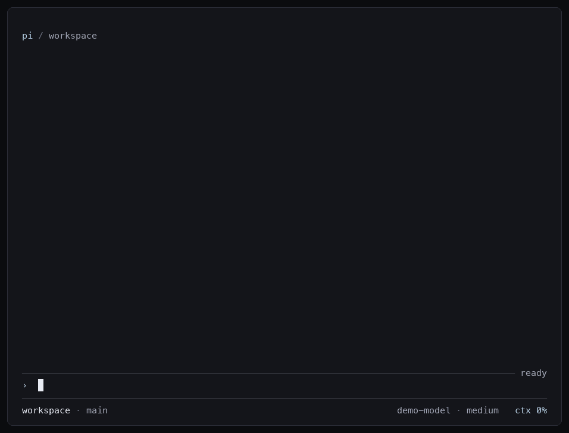

# pi-snoop-tui

A compact look for Pi's interactive terminal UI. The package ships paired light and dark themes with graphite neutrals. The accent is `#b4cde8` in dark and `okhsl(245 55% 45%)` in light. The header, transcript, editor, and footer share one gutter on both sides, set by Pi's `outputPad` setting.



## What it changes

### Tool rows

Each tool row shows a status marker, the tool name, a target, and a result summary. The marker is `·` while pending, `•` while running, `✓` when done, and `✗` on failure.

Seven tools get compact rows: `read`, `edit`, `write`, `bash`, `grep`, `find`, and `ls`. A successful call collapses to one line. A running `bash` call shows up to three output lines. A failed call shows up to five lines. Press Ctrl+O, or your configured expand shortcut, to see Pi's native result detail.

A tool with no renderer of its own gets the same one-line row. Examples are `codemode`, `pi_spawn`, and an MCP tool before its server connects. The row shows the tool name, its main string argument, and the size of its output. Expanded, it shows the arguments as compact JSON and the full plain-text output.

### Header and footer

The header shows `pi / workspace`, where the workspace is the basename of the current directory.

The footer is one line. The left side shows the workspace and the git branch. The right side shows extension statuses, the model, the thinking level, and context usage.

- The workspace is the basename of the current directory.
- The thinking level is omitted for models that do not reason.
- Context usage reads `ctx N%`, or `ctx ?` when Pi reports no usage.
- Context usage is accent-colored up to 70%, warning-colored above 70%, and error-colored above 90%. An unknown value is dim.
- When the terminal is too narrow, the footer drops segments in this order: thinking level, branch, statuses, model, context, workspace. It shortens a long status or model before it drops it. It shortens the workspace before it drops it.

### Editor

The editor sits between two thin rules. The top rule ends with `ready`, or `● working` while the agent runs. When Pi sets its own status, such as a retry countdown, that label replaces the text. A `›` prompt marks the first line, and the text starts in the same column as tool names. In bash mode the rules take the theme's bash color.

When the editor scrolls, the top rule starts with `↑ N` and the bottom rule ends with `↓ N`. `N` is the number of hidden lines in that direction.

User messages in the transcript get the same `›`, unless they start with Markdown block syntax or an inline code span.

### Working and thinking labels

The package replaces Pi's animated spinner with a static indicator. It sets the working message to `working` with `setWorkingMessage`. It sets the hidden-thinking label to `thinking` with `setHiddenThinkingLabel`. Pi uses that label in place of a hidden thinking block.

## Install

```sh
pi install npm:@justjoshn/pi-snoop-tui
```

The package requires Node `>=22.19.0`. It is built and tested against Pi 1.5.2.

Add these recommended native settings to `~/.pi/agent/settings.json`:

```json
{
  "theme": "snoop-light/snoop-dark",
  "quietStartup": true,
  "hideThinkingBlock": true,
  "outputPad": 1,
  "collapseChangelog": true,
  "autocompleteMaxVisible": 5
}
```

The theme pair follows your terminal's light or dark appearance. Use `snoop-dark` or `snoop-light` to choose one explicitly. The package never writes your settings.

The editor layout replaces the `editorPaddingX` setting. If another extension already set a custom editor, this package leaves it in place and keeps its own header and footer. Pi assigns its callbacks, key handlers, and border color directly onto the editor instance. A wrapper around another extension's editor cannot keep them in sync.

Run `pi config` to toggle `tool-rows.ts`, `footer.ts`, and `chrome.ts` independently. Chrome includes the header, the editor, the user prompt marker, and the working state. Tool rows also work with stock themes.

## Native limits

Pi owns the blank line between tool rows. This package cannot remove it through the native renderer API.

Your terminal owns the canvas background. For dark mode, set it near `#14151a`. For light mode, use `okhsl(250 12% 97%)`.

Expanded content stays native, including syntax highlighting, diffs, and truncation notices. This package does not call Pi's native call renderers, so anything Pi draws only there does not appear. That includes edit previews and the source of a successful write.

The footer replaces Pi's token and cost totals. It keeps other extensions' status messages.

## Rendering cost

The package starts no timers and performs no file or process operations. Collapsed rows memoize output summaries and style only bounded previews. The header, the footer, and the editor rules cache their rendered output. Context usage refreshes on lifecycle events, not on terminal frames. A theme change clears the component caches.

## Develop

Run these from the repository root and then the package directory:

```sh
bun install
cd extensions/pi-snoop-tui
bun run typecheck
bun run test
bun run test:coverage
```

`test:coverage` fails when branch coverage of `src/` falls below 80%, the threshold in `vitest.config.ts`.

The tests cover the shared gutter, editor rules and status labels at every width, and the user prompt marker. They also cover Pi's call-before-result ordering, isolated native renderer state, cache invalidation, theme role parity, and terminal widths with CJK text and emoji.

The repository keeps benchmarks and the demo recorder in `bench/`. The npm package does not include them.
